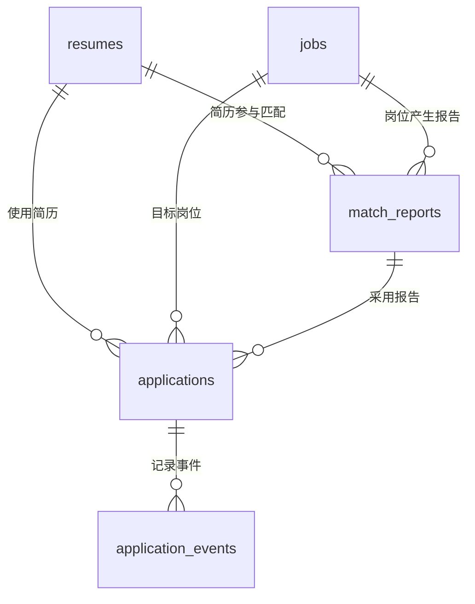

# 数据库设计与字段说明

> 更新日期：2026-10-21。以 `job-agent/app/core/database_schema.py` 为结构依据。
> [返回项目说明](../README.md) · [第四阶段实施说明](第四阶段-求职看板与MySQL持久化.md)

## 1. 五张表分别解决什么问题

| 表 | 中文名称 | 保存什么 | 为什么独立建表 |
| --- | --- | --- | --- |
| `resumes` | 简历画像 | 简历文件名、结构化候选人信息、原文预留字段 | 同一画像可以被多个岗位匹配引用 |
| `jobs` | 岗位 | 公司、岗位名、地点、JD 画像、链接 | 岗位信息独立于某次匹配报告 |
| `match_reports` | 匹配报告 | 哪份简历匹配哪个岗位、分数、完整报告、模型信息 | 同一简历和岗位可以保留多份报告 |
| `applications` | 投递记录 | 当前投递状态、备注、相关简历/岗位/报告 | 管理实际求职进展，并兼容已有看板 |
| `application_events` | 投递事件 | 创建记录、状态变更、旧记录导入快照 | 保留进展发生的过程和时间 |

目前是单用户本地项目，没有 `users` 表或用户权限隔离。

## 2. 表之间的关系



例子：测试候选人小林的一份画像保存在 `resumes`，六个岗位保存在 `jobs`，每个岗位有一份匹配报告和一条投递记录。每条迁移来的投递记录有一个“导入时状态快照”事件。

主键 `id` 表示本表一行；外键如 `resume_id` 指向另一张表的主键。外键保证引用对象存在，应用服务还负责保证投递采用的报告与简历、岗位相互一致。

## 3. 公共约定

- `id` 为整数自增主键，不承担业务含义，不应依赖它连续或固定。
- 下文“可空”表示数据库允许 `NULL`；JSON 内部字段仍按 Pydantic 业务模型校验。
- 时间按 UTC 生成并按 UTC 解释，MySQL `DATETIME` 本身不保存时区偏移。
- JSON 保存教育、项目、证据等复杂嵌套内容；分数、状态、关联 ID 等作为独立列。
- 创建表使用 SQLAlchemy Core，不是 ORM 类映射；结构升级由项目脚本负责，当前没有 Alembic。
- 新表声明 `utf8mb4`。已有 `applications` 的字符集不会被脚本强行改写。

## 4. `resumes`：简历画像表

保存可复用的候选人画像。当前保存入口没有传原始简历文本，因此原文字段先留空。

| 属性 | 类型 | 可空 | 用途与来源 |
| --- | --- | --- | --- |
| `id` | INT，主键 | 否 | 简历画像 ID，供报告和投递记录引用 |
| `content_key` | VARCHAR(64)，唯一 | 否 | 将候选人画像 JSON 规范化后计算 SHA-256，复用完全相同的画像 |
| `filename` | VARCHAR(255) | 否 | 首次写入该画像时的简历文件名，不是服务器文件路径 |
| `raw_text` | TEXT | 是 | 简历提取正文的预留字段；目前迁移和保存均不伪造正文 |
| `candidate_profile` | JSON | 否 | 完整候选人画像：基本信息、教育、技能、项目、经历、证据等 |
| `created_at` | DATETIME | 否 | 画像创建时间；旧记录回填时使用原记录创建时间 |

`content_key` 只根据画像内容计算，不包括文件名；因此六份测试记录即使文件名不同，只要画像相同，就共用一行。画像内容改变后会形成新的内容键。它不是用户身份标识，也不是上传文件字节校验和。

索引：主键 `id`、唯一键 `content_key`。

## 5. `jobs`：岗位表

保存岗位自身信息。当前每次保存新投递生成独立岗位快照，不按公司名或链接自动合并岗位。

| 属性 | 类型 | 可空 | 用途与来源 |
| --- | --- | --- | --- |
| `id` | INT，主键 | 否 | 岗位 ID |
| `source_key` | VARCHAR(100)，唯一 | 否 | 保存/迁移来源标识，保证同一迁移来源重复执行不创建重复岗位 |
| `title` | VARCHAR(255) | 是 | 岗位名称，取自岗位画像 |
| `company` | VARCHAR(255) | 是 | 公司名称，方便后续搜索和展示 |
| `location` | VARCHAR(255) | 是 | 工作地点，便于后续地点筛选 |
| `raw_description` | TEXT | 是 | 原始 JD 的预留字段；当前保存接口未提交原始 JD，保持空值 |
| `job_profile` | JSON | 否 | 职责、必备技能、加分技能、学历、时间、逐项要求及证据 |
| `job_url` | VARCHAR(2000) | 是 | 岗位来源链接；修改投递记录链接时同步更新 |
| `created_at` | DATETIME | 否 | 创建时间 |
| `updated_at` | DATETIME | 否 | 最近修改时间 |

来源键示例：旧数据使用 `legacy-application:1`，测试导入使用固定测试文件名，新的页面保存使用 `save:` 加随机 UUID。

索引：主键 `id`、唯一键 `source_key`。公司和地点已经拆列，但当前前端/API 尚未增加对应筛选条件。

## 6. `match_reports`：匹配报告表

一行表示一份已保存的分析结果。简历与岗位的组合没有唯一约束，因此结构上支持多次分析历史。

| 属性 | 类型 | 可空 | 用途与来源 |
| --- | --- | --- | --- |
| `id` | INT，主键 | 否 | 报告 ID |
| `source_key` | VARCHAR(100)，唯一 | 否 | 保存或迁移来源标识，防止同一来源重复导入 |
| `resume_id` | INT，外键、索引 | 否 | 指向 `resumes.id`，说明分析的是哪份画像 |
| `job_id` | INT，外键、索引 | 否 | 指向 `jobs.id`，说明分析的是哪个岗位 |
| `overall_score` | INT，索引 | 否 | 0～100 匹配总分，当前由业务模型校验范围 |
| `recommendation` | VARCHAR(30) | 否 | 建议投递、谨慎投递或暂不建议投递 |
| `result` | JSON | 否 | 完整报告：分数、五维评分、要求判断、证据、优势、差距和建议 |
| `provider` | VARCHAR(20) | 否 | OpenAI/DeepSeek 服务商标识 |
| `model` | VARCHAR(255) | 否 | 模型名称；测试报告为 `manual-test-fixture` |
| `created_at` | DATETIME | 否 | 保存报告的时间，旧数据沿用原记录创建时间 |

报告保存后不随投递状态变化而改写。`overall_score` 和 `recommendation` 同时保留于 JSON 中，写入服务从同一结果生成两者，直接用 SQL 修改时应避免不一致。

外键采用 `RESTRICT`：存在报告引用时，不能直接删除对应简历或岗位。当前没有报告版本号字段，可按 ID/创建时间区分记录；历史版本展示和针对同一岗位重新分析的交互仍待实现。

## 7. `applications`：投递记录表

既保留原来的完整快照字段以兼容看板，又新增关联字段。本次没有删除原有数据列或重编号已有记录。

### 7.1 业务字段与新增关联字段

| 属性 | 类型 | 可空 | 用途与来源 |
| --- | --- | --- | --- |
| `id` | INT，主键 | 否 | 投递记录 ID |
| `resume_id` | INT，外键、索引 | 是 | 使用的简历画像，指向 `resumes.id` |
| `job_id` | INT，外键、索引 | 是 | 目标岗位，指向 `jobs.id` |
| `match_report_id` | INT，外键、索引 | 是 | 本条投递采用的报告，指向 `match_reports.id` |
| `status` | VARCHAR(20)，索引 | 否 | 当前进展：待投递、已投递、笔试、面试、Offer、已拒绝 |
| `job_url` | VARCHAR(2000) | 是 | 页面正在使用的岗位链接；编辑时同步岗位表 |
| `notes` | TEXT | 是 | 用户备注；当前接口上限 5000 字符 |
| `applied_at` | DATETIME | 是 | 新建为“已投递”或首次切换到“已投递”时的时间 |
| `created_at` | DATETIME | 否 | 记录创建时间，不等同真实投递时间 |
| `updated_at` | DATETIME，索引 | 否 | 最近编辑时间 |

关联列可空是为了让旧表能逐步升级；本次回填后检查已有记录全部关联完整，更新后的正常保存流程也会写入完整关联。没有信息可追溯的旧投递日期仍为 `NULL`，不能根据“面试”等状态倒推。当前 API 尚未开放手动修改 `applied_at`。

### 7.2 为兼容旧接口保留的字段

| 属性 | 类型 | 可空 | 为什么保留 |
| --- | --- | --- | --- |
| `resume_filename` | VARCHAR(255) | 否 | 保留该次保存时的原始文件名，不受画像复用影响 |
| `candidate_profile` | JSON | 否 | 旧详情接口的候选人快照 |
| `job_profile` | JSON | 否 | 旧页面/接口的岗位快照 |
| `match_result` | JSON | 否 | 旧详情接口的报告快照 |
| `provider` | VARCHAR(20) | 否 | 旧接口展示的服务商 |
| `model` | VARCHAR(255) | 否 | 旧接口展示的模型名 |

新保存通过同一个事务写入关联表与快照。现有列表/详情响应保持不变，仍从兼容快照返回内容。以后将接口查询改为关联查询后，才适合另行规划删除冗余列。

三个外键采用 `RESTRICT`。删除投递记录会删除其事件，但保留独立的简历、岗位和报告；当前没有自动清理无引用快照的机制。

## 8. `application_events`：投递事件表

| 属性 | 类型 | 可空 | 用途 |
| --- | --- | --- | --- |
| `id` | INT，主键 | 否 | 事件 ID |
| `application_id` | INT，外键、索引 | 否 | 所属投递，指向 `applications.id` |
| `event_type` | VARCHAR(30) | 否 | 事件类别，见下表 |
| `from_status` | VARCHAR(20) | 是 | 变化前状态；创建或导入时无前态 |
| `to_status` | VARCHAR(20) | 否 | 变化后/记录时的状态 |
| `note` | TEXT | 是 | 事件说明，不是整个投递备注的版本备份 |
| `occurred_at` | DATETIME | 否 | 该事件的记录时间 |

| 类型 | 触发条件 | 说明 |
| --- | --- | --- |
| `created` | 页面或脚本创建投递 | 记录初始状态 |
| `status_changed` | 通过当前仓储把状态改为不同值 | 记录前态、后态、时间 |
| `snapshot` | 老记录迁移补齐关联 | 只代表迁移时观察到的状态，不是虚构的历史变化 |

只改链接或备注不新增状态事件；重复设置相同状态也不新增状态事件。外键采用 `CASCADE`，删除投递时同步删除所属事件。当前还没有事件列表接口和前端时间线。

## 9. 初始化、增量升级和测试数据

在 `D:\Agent\job-agent` 中运行：

```powershell
.\.venv\Scripts\python.exe -X utf8 -m scripts.init_database
```

脚本顺序：创建缺失表 → 给旧 `applications` 添加四列、外键及索引 → 回填画像、岗位、报告关联 → 记录迁移快照事件 → 补齐六条测试记录 → 回读检查。

- 原 `applications.id`、状态、备注、快照和时间保持不变，只填关联列。
- 无原文、无真实投递时间的数据保持 `NULL`。
- 已完成关联的记录跳过；已有测试标记跳过；可串行重复执行。
- 迁移采用命名锁防止同一初始化工具并发运行，但不阻止应用其他写入，执行时应暂停写操作并在完成后重启服务。
- MySQL DDL 会隐式提交，建表/加列不是一个可整体回滚的事务；DML 回填和测试插入各自使用事务。失败后可在检查原因后重跑缺失步骤。
- 不会自动备份或删除数据；重要数据执行结构变更前应自行备份。
- 只需补样例时可运行原 `scripts.seed_applications`，旧库首次使用必须先运行初始化工具。

### 本次实际数据

2026-10-21，真实 MySQL 回填了原有六条虚构投递，没有再创建重复投递。

| 表 | 本次初始化后数量 | 数据来源 |
| --- | --- | --- |
| `resumes` | 1 | 六条测试记录的候选人画像完全相同，合并引用 |
| `jobs` | 6 | 六个虚构公司岗位 |
| `match_reports` | 6 | 六份人工测试报告，48～94 分 |
| `applications` | 6 | 原有 ID 1～6，覆盖六种状态 |
| `application_events` | 6 | 六条迁移时状态快照 |

测试记录名称含 `【测试】`，备注含 `[board-demo-v1]`，模型为 `manual-test-fixture`；它们不是实际模型评估，也不是真实招聘信息。

## 10. 文件职责和验证

| 文件 | 作用 |
| --- | --- |
| `app/core/database_schema.py` | 五张表、外键、索引和字段声明的唯一来源 |
| `app/services/application_relations.py` | 画像复用、岗位/报告保存、事件追加 |
| `app/services/application_repository.py` | 保持原 CRUD 接口，新建/状态更新同步关系表 |
| `app/models/application.py` | 拒绝显式空状态，防止数据库非空列冲突 |
| `scripts/init_database.py` | MySQL 增量建表、关联回填、导入和关联检查 |
| `scripts/seed_applications.py` | 六条带固定标记的测试数据，保存时写入关联 |
| `tests/test_database_relations.py` | 关联复用、状态事件、投递时间、级联删除、重复导入、旧快照保留 |

自动化测试使用临时 SQLite；实际 MySQL 建表、六条旧数据回填与完整性检查单独执行。本次没有调用大模型。具体执行结果同步记录在根目录 README；不要将临时 SQLite 测试等同于所有 MySQL 行为已验证。

本次真实 MySQL 验证还检查了五张表及六个外键，重跑初始化未增加数据；使用 FastAPI TestClient 验证旧看板列表、分数降序和完整详情仍正常。真实数据库的新增状态流转和删除未另行执行，以保留这批测试样例；相关事务与级联行为由临时 SQLite 测试覆盖。

## 11. 后续扩展边界

当前已有五表结构和兼容写入，但尚未提供独立简历管理、岗位收藏、报告历史、事件时间线 API 或页面。原文预留列尚未接入上传/保存流程。岗位去重、用户隔离、报告版本 UI、数据库分页及并发画像去重重试可以后续逐步实现。

数据库外键确保存在性，不通过复合约束强制 `applications` 的三个关联 ID 与报告内部两个 ID 一致；当前写入服务和初始化检查保证该规则，直接 SQL 编辑须自行遵循。
